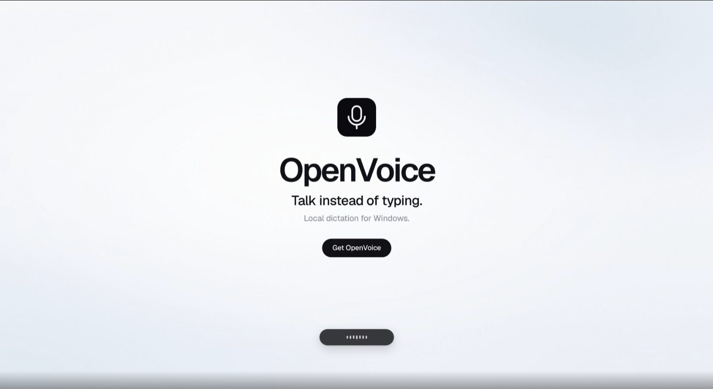
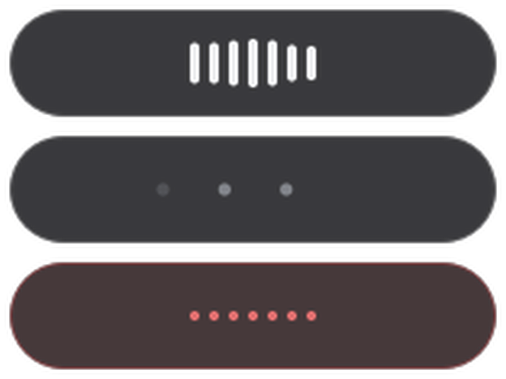

<div align="center">



# OpenVoice

**Talk instead of typing. Local dictation for Windows.**

Hold a key, speak, release — the text lands in whatever window has focus.
Fully local: the speech model runs on your machine. No cloud, no account, no API key,
no subscription.

[**Launch film**](media/launch.mp4) · [**Design & engineering record**](docs/openvoice.md) · [**Verification**](#verification)


-34c759)


</div>

---

## What this is

OpenVoice is a Windows tray application that turns speech into text in any focused
application. It is modelled on WisprFlow's interaction — a global push-to-talk key, a small
floating indicator, and automatic insertion — but rebuilt entirely offline.

| | |
|---|---|
| **Always available** | Global hotkeys work from any application; a tray icon is the only chrome. |
| **Never in the way** | The floating pill is click-through and never takes focus; your clipboard is restored after every paste. |
| **Fully local** | faster-whisper runs on your CPU or GPU. Audio never leaves the machine. |
| **Multilingual** | The spoken language is detected per dictation — English, Chinese, Japanese, Thai, Vietnamese, Indonesian, French, Spanish and about ninety more — and each language is post-processed with its own rules. |

<div align="center">

</div>

## Feature tour

**One key, one gesture.** Hold `Right Alt` and speak; release and the text appears. Prefer a
tap? `F9` toggles. `Esc` throws the recording away. Windows key auto-repeat is filtered, so
holding the key cannot re-trigger itself.

**The pill.** A 200 × 44 px capsule painted by hand at 60 Hz, bottom-centre of the screen.
Seven bars ride a fast-attack / slow-release envelope with per-bar delays and gains, so a
spoken syllable travels across the pill; a quiet mic keeps a visible breathing pulse. While
transcribing, the bars cross-fade into three travelling dots. When nothing was heard, one
dim red flash — and nothing is inserted. The pill is click-through and never steals focus.

**The engine chooses itself.** On a machine with CUDA it resolves `auto` to
`large-v3` — the most accurate locally runnable whisper — at beam 5. Without a GPU it uses
the multilingual `small` model (`small.en` if you force English). Models are never
downloaded at runtime: `tools/fetch_model.py` is the only network operation, and it is
manual by design.

**Language detection is a pre-pass, not an afterthought.** When the language is `auto`, the
transcriber asks the model for its language first (one encoder pass), then decodes with that
language pinned. That ordering matters: whisper treats the vocabulary prompt as prior
context, and an English prompt demonstrably pulls a non-English dictation back into English.
Knowing the language first lets the prompt, the hallucination list and the post-processing
all be chosen for the right language.

**It refuses to guess.** Whisper hallucinates on non-speech — one 2025 study measured text
from 40.3 % of 301,317 non-speech clips. OpenVoice rejects rather than inserts: a
whole-transcript match against per-language filler-phrase lists, plus compression-ratio,
log-probability, no-speech and temperature checks. A rejected transcript is a red flash and
an honest log line, never pasted text.

**It never mangles your clipboard.** Text is pasted with Ctrl + V, then the previous
clipboard is restored ~300 ms later — and only if you have not copied something new in the
meantime.

**It learns your names.** No vocabulary ships with the app: the words worth rescuing are
yours, and someone else's project names would only be noise. Add terms in the tray, or let
the CorrectionLearner pick them up from your own corrections — a term becomes active after
two sightings, so a one-off typo can never rewrite text.

## Measured, not asserted

The project's evidence standard: structural checks (no exceptions, non-empty output) prove
nothing about behaviour, so every claim below comes from a check that can fail.

**Multilingual accuracy**, real human speech from public research datasets (FLEURS,
LibriSpeech, JSUT), three clips per language, through the real pipeline, `large-v3` on CUDA
with automatic detection (2026-09-28):

| language | metric | mean | detected | rejected |
|---|---|---|---|---|
| English | WER | 0.0 % | 3/3 | 0 |
| French | WER | 5.9 % | 3/3 | 0 |
| Spanish | WER | 0.0 % | 3/3 | 0 |
| Indonesian | WER | 7.9 % | 3/3 | 0 |
| Chinese | CER | 10.9 % | 3/3 | 0 |
| Japanese | CER | 3.3 % | 3/3 | 0 |
| Thai | CER | 0.7 % | 3/3 | 0 |
| Vietnamese | WER | 8.5 % | 3/3 | 0 |

24/24 clips were detected correctly and nothing was wrongly rejected. Three clips per
language is a smoke test, not a benchmark — the tool prints its own artifacts (a duplicate
reference, a dataset row whose reference was longer than its audio) rather than hiding them
in the mean.

**English, on the author's own voice**, 8-probe diagnostic benchmark (`tools/benchmark.py`):
95.0 % mean across the seven scorable probes, against a stated target of 89–90 % — including
100 % on numbers, punctuation and homophones. Synthetic speech to text: 7/7 sentences exact
at 0.00 % word error.

**Suite:** 293 unit and integration tests. The VAD threshold and the new post-processing
gates each have a negative control — a deliberately broken version the check must catch.

```
.venv\Scripts\python.exe -m pytest                       # unit + integration suite
.venv\Scripts\python.exe tests\negative_control_vad.py   # proves the VAD tests can fail
.venv\Scripts\python.exe tools\lang_bench.py             # per-language WER/CER, real speech
.venv\Scripts\python.exe tools\mic_check.py --seconds 5  # YOUR microphone, spectrum included
```

## Quick start

Requires Windows 10/11 and Python 3.11. A CUDA GPU is optional; the first run on a GPU
machine expects the `large-v3` model in the HuggingFace cache.

```
git clone https://github.com/pfarell/openvoice
cd openvoice

python -m venv .venv
.venv\Scripts\pip install -r requirements.txt

.venv\Scripts\python tools\fetch_model.py --model large-v3   # ~3 GB, GPU (recommended)
#    or on a CPU-only machine:
#    .venv\Scripts\python tools\fetch_model.py --model small

run_dictate.bat
```

The app appears as a tray icon. Double-clicking `run_dictate.bat` starts it with no console
window; `run_dictate.pyw` does the same; `.venv\Scripts\python.exe app.py` gives you output.

| action | default key |
|---|---|
| Hold to talk (release to insert) | `Right Alt` |
| Tap once to start, tap again to stop | `F9` |
| Throw the recording away | `Esc` while recording |
| Toggle recording | left-click the tray icon |

Everything else lives in the tray menu: recording mode, auto-enter, trailing space,
microphone, a Language submenu (Auto + 24 languages), custom vocabulary, indicator on/off,
start with Windows, quit. The full settings file is `%APPDATA%\OpenVoice\config.json`.

**Auto-enter is off by default.** Turn it on and the pill shows a small `↵` — be careful in
chat apps: it will send the message.

## How it works

```
app.py          entry point: QApplication, bus, wiring, single-instance lock, lifecycle
bus.py          the only cross-module channel (Qt signals)
config.py       JSON settings, atomic writes, corrupt-file quarantine
audio.py        capture, sanitising, adaptive silence trim, level normalisation
transcribe.py   faster-whisper wrapper: detection pre-pass, engine choice, confidence gate
formatting.py   language-routed inverse text normalisation
vocabulary.py   prompt shaping, term mining, correction learning
hotkeys.py      pure hold/toggle/cancel state machine + pynput listener
injector.py     clipboard paste into the focused window, clipboard restore
indicator.py    the floating pill, QPainter at 60 Hz
tray.py         tray icon and settings menu
history.py      the last N dictations as WAV + text, with language metadata
```

Dependency direction is one-way: `app.py` imports everything; every module imports only
`bus`, `config` and the standard library or a third-party package. Threading is deliberately
small: the Qt main thread owns the UI and the clipboard, one worker thread runs the model
per utterance, one loads the model at startup, and pynput owns the hotkeys. The bus is the
only way modules talk.

Two decisions carry most of the quality:

- **Language routing in `formatting.py`.** Chinese, Japanese and Thai are written without
  spaces, so the space-token pipeline would mangle them — they take a character-level branch.
  The English word tables never run on French, Spanish, Indonesian or Vietnamese, because
  "million" is an English scale word and would rewrite *deux million d'euros* as
  *deux 1,000,000 d'euros*. A test asserts exactly that pair, in both directions.
- **Audio conditioning before the model.** An 80 Hz high-pass for DC and rumble, band-limited
  resample to 16 kHz, an adaptive silence trim that can only ever be more permissive than the
  fixed threshold, then level normalisation. No denoising: speech enhancement measurably
  raised whisper's error rate, and whisper's front end is trained on unprocessed audio.

The full engineering record — the indicator's geometry, animation curves and exact palette,
the detection flow, the hallucination gate, every measurement and every honest limitation —
is in **[docs/openvoice.md](docs/openvoice.md)**.

## Honest limitations

- **Windows only, for now.** Selective hotkey suppression and the clipboard path are
  Windows-specific by design.
- **Accuracy varies by language.** On the measured sample Chinese was weakest (its failure
  mode is code-switching into English words), and Vietnamese/Indonesian names and numbers
  still slip. Spoken-number conversion is English-only today; the other languages get
  punctuation, percent, currency and decimal handling.
- **A cold microphone costs the first syllable.** If your input array sleeps, start your
  first word a beat after pressing the key, or keep `keep_mic_warm` on. `tools/mic_check.py`
  explains driver-level voice processing that no model can undo.
- **CPU latency is roughly 0.3× realtime** with `small`; a 10 s dictation is a 3–4 s wait.
  The GPU path is the fix and is automatic when CUDA is present.
- **Synthetic input cannot reach elevated windows**, and apps that deliberately ignore
  synthetic keyboard input receive nothing.

## Data and acknowledgements

- [faster-whisper](https://github.com/SYSTRAN/faster-whisper) (CTranslate2) runs the models;
  the models are OpenAI's Whisper, released under MIT. Silero VAD is not used at runtime —
  the app's own adaptive trim does the work.
- The multilingual benchmark fetches a few clips from public research datasets on demand
  (FLEURS, CC-BY-4.0; LibriSpeech, CC-BY-4.0; JSUT, CC-BY-SA-4.0). No audio is redistributed
  in this repository; `tools/lang_bench.py --fetch` downloads it into a git-ignored folder.
- No paid APIs, cloud services or subscriptions are used anywhere in this project.

## License

[MIT](LICENSE) © 2026 Praditya Farell
